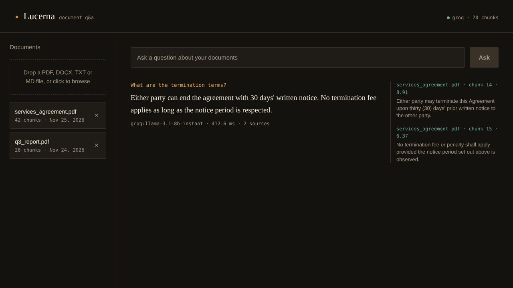

# Lucerna

Ask questions about your own documents and get answers with the passages they came from. Upload PDF, DOCX, TXT or Markdown files; Lucerna splits them into chunks, indexes them, and answers questions using only what it retrieves.



## How it works

1. **Ingest:** text is extracted and split into chunks of whole sentences (default ~800 characters, with some overlap between chunks), then embedded with `all-MiniLM-L6-v2` and stored in a FAISS index.
2. **Retrieve:** the question is embedded and the top 8 chunks are fetched.
3. **Re-rank:** a cross-encoder (`ms-marco-MiniLM-L-6-v2`) re-scores those chunks and keeps the best 3.
4. **Answer:** the chunks are passed to the LLM, which is told to answer only from that context. The response includes each source chunk and its score.

By default everything runs locally (flan-t5 for answers), so no API key is needed. Set `LLM_PROVIDER` to `openai` or `groq` for better answers.

## Running it

**Docker**

```bash
cp backend/.env.example backend/.env
docker compose up --build
```

Open http://localhost:5173.

**Without Docker**

```bash
cd backend
python -m venv .venv && source .venv/bin/activate
pip install -r requirements.txt
cp .env.example .env
uvicorn app.main:app --reload
```

```bash
cd frontend
npm install
npm run dev
```

The first upload downloads the embedding and re-ranking models (about 170 MB); with `LLM_PROVIDER=local` the first question also downloads flan-t5 (about 1 GB).

## API

| Method | Path | Description |
|---|---|---|
| GET | `/api/health` | Status, LLM provider, document and chunk counts |
| GET | `/api/documents` | Uploaded documents, newest first |
| POST | `/api/documents` | Upload a file (multipart field `file`) |
| DELETE | `/api/documents/{id}` | Remove a document and its chunks |
| POST | `/api/query` | `{"question": "...", "document_ids": [...]}` (ids optional) |

Interactive docs are at http://localhost:8000/docs.

## Tests

```bash
cd backend
pytest -v
```

28 tests covering chunking, file parsing, the vector store (search, filtering, deletion, persistence), the ingest and query pipeline, and the API. The embedding model, re-ranker and LLM are replaced with small fakes, so the tests run in under a second without downloading anything.

## Project layout

```
backend/
  app/
    api.py         routes
    pipeline.py    ingest and ask
    store.py       FAISS index + document metadata
    chunking.py    sentence-based chunking
    parsing.py     PDF / DOCX / text extraction
    embeddings.py  sentence-transformers
    reranker.py    cross-encoder
    llm.py         local, OpenAI and Groq providers
  tests/
frontend/
  src/App.jsx, api.js, styles.css
```

## Limitations

- Answers are not streamed; they arrive in one response
- Deleting a document rebuilds the index, which is fine for hundreds of documents but slow for very large collections
- No authentication, so it is meant for local use

## License

MIT
